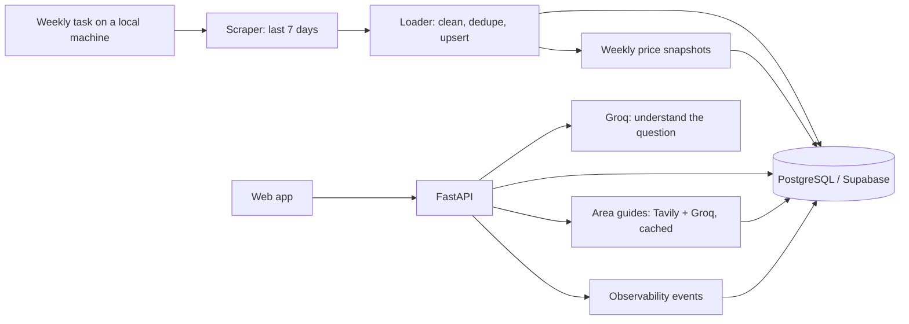

# Lagos Rent

Rent research for Lagos, answered from real listings.

Ask a question in plain language, such as *"How much is a 2 bedroom in Yaba?"*, and get the typical yearly rent, the price range, and the listings behind the answer. Every rent figure comes from property listings collected each week. When the data is thin, the app says so instead of guessing.

## Features

- **Ask in plain language.** Questions are parsed by an LLM into area, size and budget, then answered with SQL over stored listings. Follow-up questions keep context ("what about a 3 bedroom?").
- **Clear answers.** Typical rent, the range most listings fall in, a breakdown by size, how many listings were used, how fresh they are, and a confidence level.
- **Area guides.** Rent by size, weekly price trends, newest listings, and notes on commute, flooding, power, safety and amenities, summarised from cited web sources.
- **Compare areas.** Up to three areas side by side for a chosen size.
- **Move-in cost calculator.** Yearly rent plus agency, legal and caution fees, service charge and moving costs.
- **Saved searches and favourites.** Kept per device, no sign-up.
- **Weekly data refresh.** A scheduled task collects listings from the last 7 days and loads them automatically.
- **Private admin console.** Usage analytics, scraper operations, and full observability: traffic, latency, errors, AI call costs and data quality.

## How it works



1. **Collect.** Every Monday a scheduled task scrapes rent listings from public Nigerian property sites. It keeps only listings dated within the last 7 days, and respects each site's robots.txt.
2. **Load.** Listings are normalised (area names, monthly to yearly prices), de-duplicated, and upserted into Postgres. Weekly price snapshots are recomputed for trends.
3. **Answer.** The API extracts what the user is asking, queries matching listings, and returns a typed answer with figures, range method and confidence.

## Tech stack

| Layer | Tools |
| --- | --- |
| Backend | Python 3.12, FastAPI, SQLAlchemy, Pydantic, Typer |
| Data | PostgreSQL (Supabase), pandas, RapidFuzz |
| AI | Groq (question understanding, guide writing), Tavily (web search) |
| Scraping | requests, BeautifulSoup |
| Frontend | React 19, TypeScript, Vite, Tailwind CSS, TanStack Query |
| Tooling | uv, Ruff, mypy, pytest, Vitest, ESLint |
| Scheduling | Windows Task Scheduler, GitHub Actions (manual runs) |

## Getting started

### Prerequisites

- [uv](https://docs.astral.sh/uv/) (installs Python 3.12)
- Node.js 20 or newer
- A PostgreSQL database (Supabase works out of the box)
- API keys for [Groq](https://console.groq.com) and [Tavily](https://tavily.com)

### Setup

```bash
git clone https://github.com/Jaywestty/Lagos-Rent-Predictor.git
cd Lagos-Rent-Predictor
cp .env.example .env          # then fill in the values below
uv sync
npm install --prefix frontend
uv run python -m entrypoints.cli migrate
```

### Environment variables

| Variable | Required | Purpose |
| --- | --- | --- |
| `DATABASE_URL` | Yes | Postgres connection string. For Supabase, use the Session pooler URI. TLS is enabled automatically for remote hosts. |
| `GROQ_API_KEY` | Yes | Understanding questions and writing area guides |
| `TAVILY_API_KEY` | Yes | Web search for area guides and general advice |
| `GROQ_MODEL` | No | Defaults to `openai/gpt-oss-120b` |
| `ADMIN_EMAIL`, `ADMIN_PASSWORD` | No | Used once by `create-admin` |
| `POSTGRES_*` | No | Local Postgres fallback when `DATABASE_URL` is not set |

Never commit `.env`.

### Run locally

```bash
uv run uvicorn entrypoints.api:app --port 8000     # API
npm run dev --prefix frontend                       # Web app on http://localhost:5173
```

The Vite dev server proxies `/api` to the backend.

### Load data

```bash
# Scrape the last 7 days and load it (what the weekly job runs)
uv run python -m entrypoints.cli weekly-scrape --since-days 7 --max-pages 30

# Pre-build area guides for the 15 busiest areas
uv run python -m entrypoints.cli warm-guides --top 15
```

### Admin access

The admin console lives at `/admin` and is not linked anywhere in the public site. Accounts can only be created from the command line:

```bash
uv run python -m entrypoints.cli create-admin
```

Admin sessions use Argon2-hashed passwords, HttpOnly cookies, CSRF tokens on every change, and login lockout after repeated failures.

## Scheduled scraping

Some listing sites refuse requests from cloud servers, so the weekly run happens on a local Windows machine with Windows Task Scheduler:

```powershell
powershell -ExecutionPolicy Bypass -File scripts\register-weekly-task.ps1
```

This registers **Lagos Rent weekly scrape** for every Monday at 09:00. If the machine is off or asleep then, Windows runs it at the next opportunity. Each run looks back 7 days, so a late run misses nothing. The task needs an internet connection and the `.env` file in the project folder. Logs are written to `logs\weekly-scrape-*.log` and kept for 60 days.

Run it now, or remove it:

```powershell
Start-ScheduledTask -TaskName "Lagos Rent weekly scrape"
Unregister-ScheduledTask -TaskName "Lagos Rent weekly scrape"
```

A site that refuses access is skipped for that run and the run is marked *partial* (or *failed* if nothing was collected), visible in the admin console.

`.github/workflows/weekly-scrape.yml` is kept for manual cloud runs (**Run workflow** in the Actions tab) of sites that allow cloud traffic. It needs the `DATABASE_URL` repository secret, plus `GROQ_API_KEY` and `TAVILY_API_KEY` to pre-build area guides.

## Testing and quality

```bash
uv run pytest            # backend tests (never touch the real database)
uv run ruff check
npm test --prefix frontend
npm run lint --prefix frontend
npm run build --prefix frontend   # includes a bundle size budget
```

## Project structure

```
admin/          Admin API: auth, analytics, operations, observability
advice/         Web search, advice answers and area guides
conversation/   Session memory for follow-up questions
entrypoints/    FastAPI app, public API routes and the Typer CLI
eval/           Extraction and advice evaluation sets
observability/  Request, error, AI-call and usage event recording
pipeline/       CSV loader with de-duplication and a quality report
query/          Question parsing, SQL queries, stats, trends and answer shape
scraping/       Listing scrapers, location normaliser and the scrape-and-load runner
sql/            Base schema and numbered migrations
frontend/       React web app and admin console
tests/          Backend tests
```

## API overview

| Method | Path | Description |
| --- | --- | --- |
| `POST` | `/api/chat` | Ask a question; returns a typed answer plus matching listings |
| `POST` | `/api/chat/stream` | Same, as server-sent events |
| `GET` | `/api/areas` | Areas with listing counts and typical rent |
| `GET` | `/api/areas/{area}` | Rent by size and trend for one area |
| `GET` | `/api/areas/{area}/guide` | Area guide with cited sources |
| `GET` | `/api/areas/{area}/trends` | Weekly typical rent for a size |
| `GET` | `/api/areas/{area}/listings` | Newest listings in an area |
| `GET` | `/api/compare?areas=A,B,C&beds=2` | Side-by-side comparison |
| `GET` `POST` `DELETE` | `/api/me/saved-searches`, `/api/me/favorites` | Per-device saved items (`X-Client-Id` header) |
| `GET` | `/health` | Health check |

Admin endpoints live under `/api/admin` and require an admin session.

## Data notes

- Lagos rent is quoted per year. Monthly prices are multiplied by 12. A listing with no stated period is treated as yearly.
- Ranges use the 10th to 90th percentile once there are 10 or more listings, and the lowest to highest price below that.
- Confidence is *solid* at 10 or more listings, *limited* at 4 to 9, and *very little data* at 3 or fewer.
- Some source listings tag a yearly price as monthly. The app flags these on listing cards and in the admin data-quality view.
- No IP addresses or personal data are stored. Saved items are tied to a random per-device ID.
