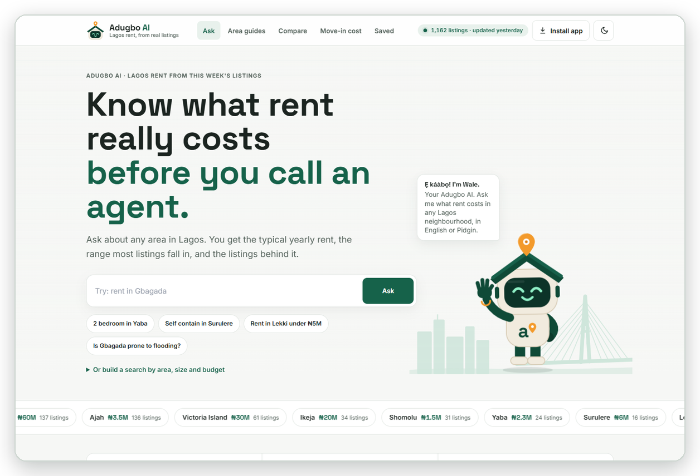
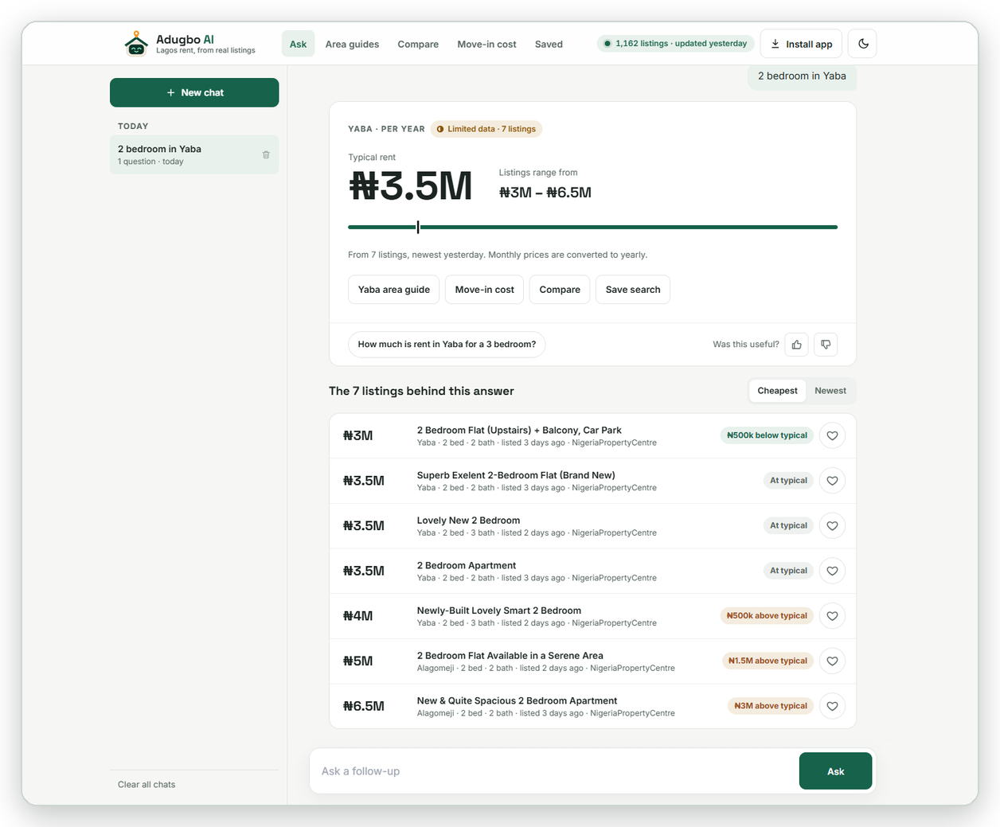
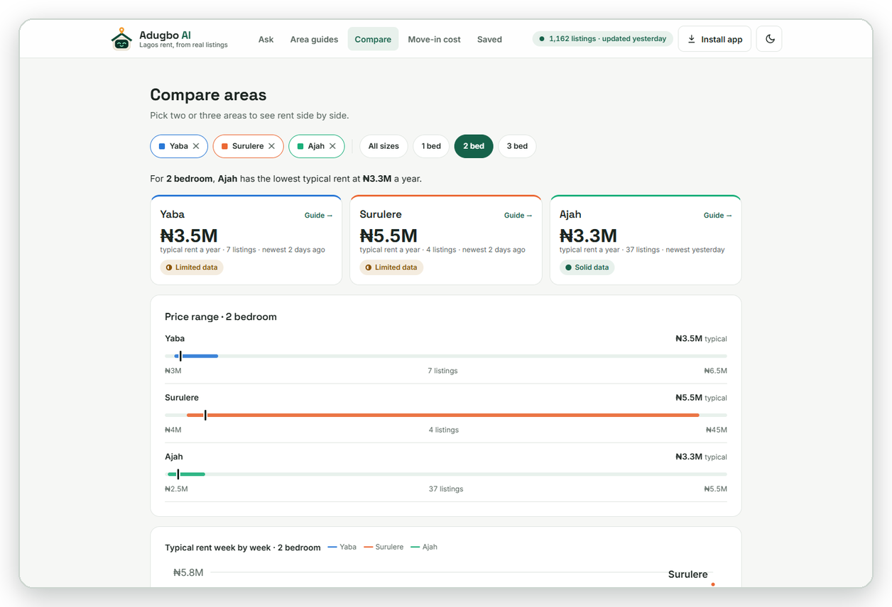
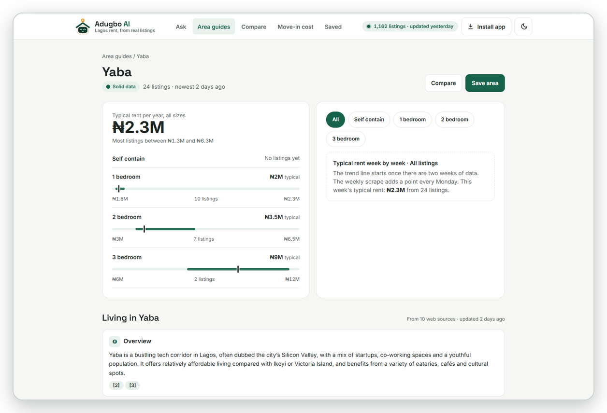
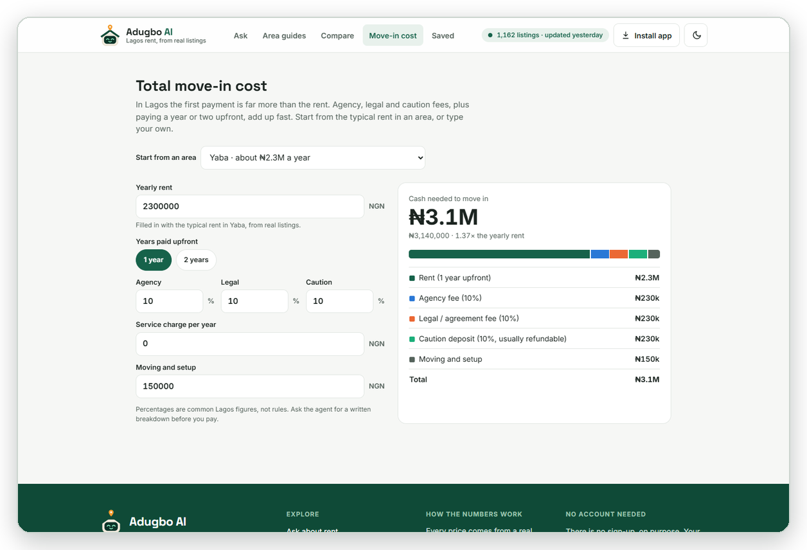
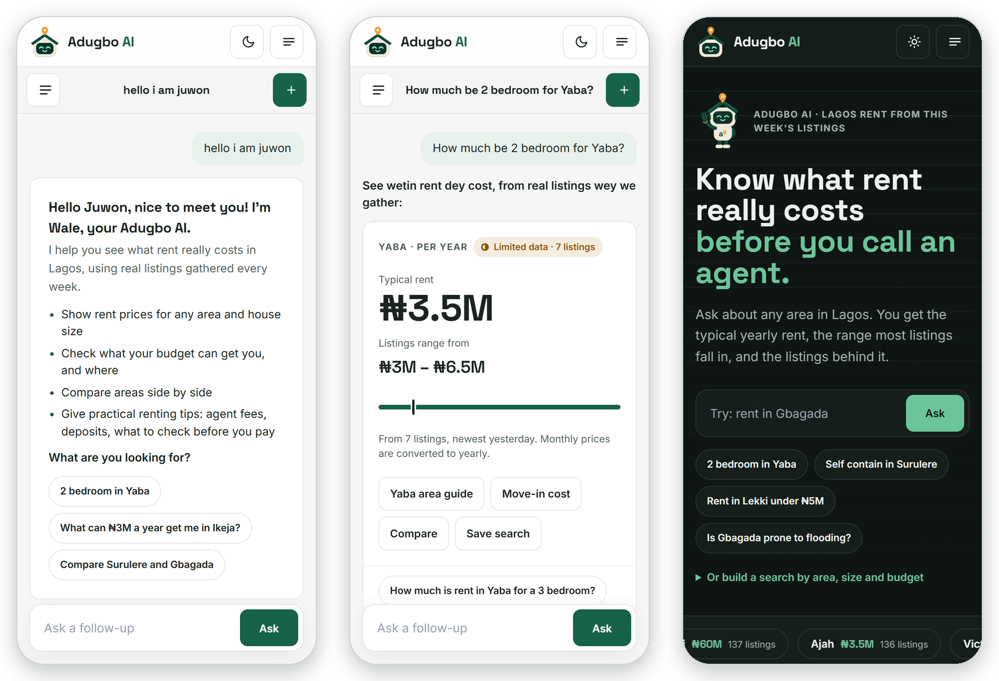
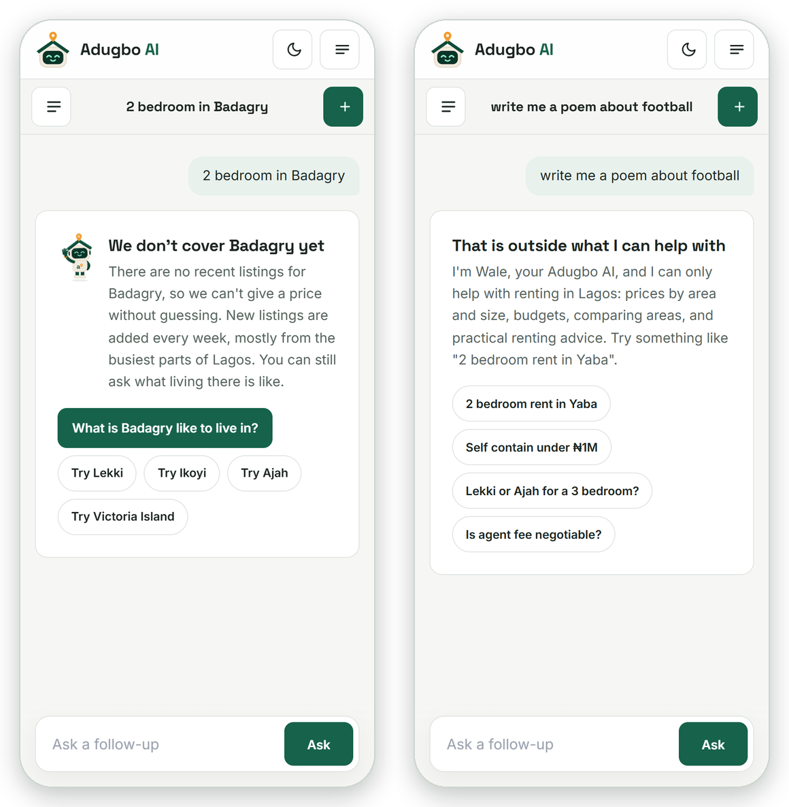
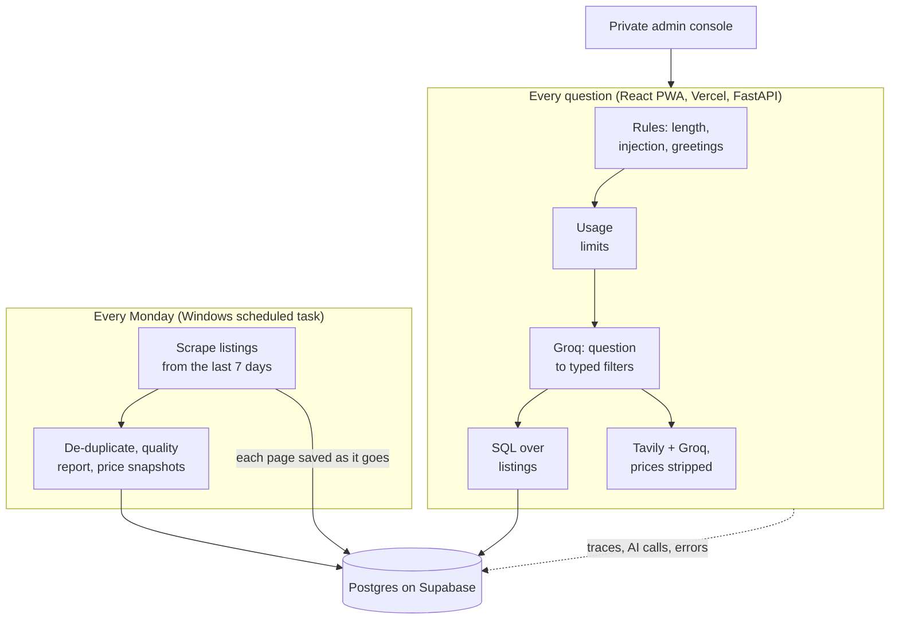

<div align="center">

# Adugbo AI

**Know what rent in Lagos really costs, before you call an agent.**

Ask in plain English or Nigerian Pidgin. Get the typical yearly rent, the range, and the real listings behind every number.

[**Try it live → adugbo-ai.vercel.app**](https://adugbo-ai.vercel.app)




</div>

*Àdúgbò* is Yoruba for "neighbourhood". Adugbo AI collects rent listings from Nigerian property sites every week. It answers questions like *"How much is a 2 bedroom in Yaba?"* with figures calculated from those listings, never from an AI's guess.

---

## Contents

- [The problem](#the-problem)
- [What you get](#what-you-get)
- [Meet Wale](#meet-wale)
- [Honest by design](#honest-by-design)
- [How it works](#how-it-works)
- [Engineering decisions](#engineering-decisions)
- [Tech stack](#tech-stack)
- [Run it locally](#run-it-locally)
- [Deployment](#deployment)
- [Testing and quality](#testing-and-quality)
- [Reference](#reference)
- [Limitations and what's next](#limitations-and-whats-next)

---

## The problem

Renting in Lagos is hard to do well:

- **There is no reference price.** Listings are spread across sites and agents, and the same kind of flat can be advertised at wildly different prices. Without a sense of the normal range, you can't tell a fair price from an inflated one.
- **Prices go stale fast.** Rent moves quickly, so last year's blog post or a friend's quote is often wrong.
- **The rent is not the bill.** Agency, legal and caution fees, often on top of one or two years paid upfront, can push the cash needed to move in far above the yearly rent.
- **Areas are hard to judge from a distance.** Flooding, traffic, power and safety matter as much as price, and that information is scattered across the web.

## What you get



Every answer shows:

- the **typical yearly rent**
- the **range** most listings fall in
- **how many listings** it rests on, with a plain confidence label (*Solid data*, *Limited data*, *Very little data*)
- **the listings themselves**, each marked as below, at or above typical, and each linking to its source

Monthly prices are converted to yearly, and listings whose price looks mistyped are flagged.

| Compare areas side by side | Area guides | Total move-in cost |
| :---: | :---: | :---: |
|  |  |  |
| Up to three areas for the size you need. The cheapest is named, and each area shows its own data confidence. | Rent by size from listings, plus commute, flooding, power and safety, summarised from linked web sources. | Rent plus agency, legal and caution fees, upfront years and moving costs. Every figure is editable. |

You also get chat history, saved searches and favourite listings, all without an account. The app installs to your phone or desktop as a PWA and keeps working offline for pages you've already opened.

## Meet Wale



Wale is the assistant's persona: a house-headed robot with a map pin on his roof, drawn in SVG.

- **He greets you back.** "Hi", "good morning", "how far" or "bawo ni" get an introduction, what he can do, and questions to tap. If you introduce yourself ("hello, I am Juwon"), he uses your name.
- **He speaks Pidgin.** Ask *"How much be 2 bedroom for Yaba?"* and advice is written in Pidgin, while listing answers get a Pidgin line above the same figures. He recognises the usual spellings (*howfar*, *watin*, *how bodi*).
- **Greetings cost nothing.** They are matched by rules before any AI call, so they are instant, free, and never count toward usage limits. The name you give is used for that one reply and is not stored.

## Honest by design



- **The AI never produces a number.** It only turns the question into structured filters. Every price comes from SQL over stored listings, and any figures in web text used for advice are stripped out before you see them.
- **No data, no guess.** A misspelt area gets *"Did you mean Yaba?"*. A covered area with no listings of that size says so. An area with no listings at all (*Badagry*) is named as not covered yet, with useful next steps.
- **It stays on topic.** Questions that aren't about renting in Lagos, and obvious attempts to override its instructions, are declined before any AI or search call is made. Web content is treated as data, never as instructions, and links in answers can only point to the cited sources.
- **Fair use for everyone.** Usage limits apply per device, per network and for the whole app, so one script can't use up the AI budget for everyone else.
- **No sign-up, on purpose.** Checking a price should take seconds, not a form. History and saved items are tied to a random ID in your browser. There are no accounts and no personal data, so there's nothing to leak.

---

## How it works



What happens when someone asks **"How much be 2 bedroom for Yaba?"**:

1. **Rules first, at no cost.** Length check, prompt-injection patterns, greeting and thanks detection, and language detection (Pidgin here). Nothing so far has called an AI.
2. **Usage limits.** The question is counted against the device, the network and the daily total. Over a limit, the user gets a friendly *"wait about N seconds"* reply.
3. **Understanding.** Groq turns the question into typed entities (`lookup`, beds 2, area Yaba) using a prompt with worked examples, including Pidgin ones. Follow-ups inherit the previous question's filters.
4. **Answering.** Lookups, budgets and comparisons run as SQL over listings and come back in a typed answer: typical rent, range method (10th to 90th percentile at 10 or more listings, lowest to highest below that) and confidence. Advice goes to web search and is written up by the model, with price sentences removed.
5. **Wale's voice.** Pidgin users get a Pidgin line above the figures, and advice is generated in Pidgin.
6. **Record.** The exchange is saved to the device's chat history, and the request is traced: stage timings, AI latency and tokens, errors.

## Engineering decisions

**The model reads; the database counts.** An LLM asked "what does rent cost in Yaba?" will confidently invent a number. Here the model's only job is to produce filters that are checked against a schema. Every price shown is calculated from listings, and figures inside web search results are removed before they reach the user. Wrong understanding is possible. An invented price is not.

**Rules before the model.** Greetings, thanks, empty or overlong input and obvious injection attempts are handled by plain rules. That makes them instant and deterministic, keeps them out of the rate limit, and means a flood of "hi" messages costs nothing.

**Rate limits sized for Lagos networks.** Many phones on Nigerian mobile networks share one public IP address. A strict per-address limit would block real people, so there are three tiers:

| Tier | Default | Purpose |
| --- | --- | --- |
| Per device | 8 a minute, 100 a day | Stops one browser hammering the chat |
| Per network address | 20 a minute, 400 a day | Catches scripts that rotate device IDs; looser for shared addresses |
| Whole app | 3,000 a day | A hard ceiling on AI spend that no header can get around |

Limits reset at midnight Lagos time and can be changed with environment variables. The first time a limit is hit, an alert appears on the admin Observability page, with addresses hashed.

**Scraping runs on a home machine, not in the cloud.** Some listing sites refuse requests from cloud servers, so the weekly scrape runs from Windows Task Scheduler and writes to the same Supabase database the live site reads. Runs save each page as they go, resume after a stop, and are marked *interrupted* when their heartbeat goes quiet.

**One web address, no CORS.** Vercel forwards `/api/*` to the Render backend, so the browser only ever talks to one origin. The admin session cookie just works, and there's no cross-origin setup to get wrong.

**Observability never fails a request.** Events go through a queued writer, and timing records are best-effort. A database blip can lose a trace, but it can never fail the user's question.

**Freshness over volume.** The scraper keeps only listings dated within the last 7 days. Answers say how many listings they use and how recent the newest is, so a thin answer looks thin.

## Tech stack

| Layer | Tools |
| --- | --- |
| AI | Groq (`openai/gpt-oss-120b`) for question understanding, advice and guide writing; Tavily web search |
| Backend | Python 3.12, FastAPI, SQLAlchemy, Pydantic, Typer CLI |
| Data | PostgreSQL on Supabase (row-level security on), pandas, RapidFuzz for "did you mean" |
| Scraping | requests, BeautifulSoup, JSON-LD parsing |
| Frontend | React 19, TypeScript, Vite, Tailwind CSS, TanStack Query, service worker and web manifest |
| Security | Argon2 admin passwords, HttpOnly session cookies, CSRF tokens, login lockout |
| Tooling | uv, Ruff, pytest, Vitest, ESLint, a bundle size budget |
| Hosting | Vercel (web), Render (API), Supabase (database), GitHub Actions (keep-awake ping), Windows Task Scheduler (weekly scrape) |

## Run it locally

Prerequisites: [uv](https://docs.astral.sh/uv/) (installs Python 3.12), Node.js 20+, a PostgreSQL database (Supabase works out of the box), and API keys for [Groq](https://console.groq.com) and [Tavily](https://tavily.com).

```bash
git clone https://github.com/Jaywestty/Lagos-Rent-Predictor.git
cd Lagos-Rent-Predictor
cp .env.example .env                      # fill in the values below
uv sync
npm install --prefix frontend
uv run python -m entrypoints.cli migrate  # create tables (safe to repeat)
```

```bash
uv run uvicorn entrypoints.api:app --port 8000   # API
npm run dev --prefix frontend                     # web app on http://localhost:5173, proxies /api to :8000
```

### Environment variables

| Variable | Required | Purpose |
| --- | --- | --- |
| `DATABASE_URL` | Yes | Postgres connection string. For Supabase, use the Session pooler URI. TLS is turned on automatically for remote hosts. |
| `GROQ_API_KEY` | Yes | Question understanding, advice and area guides |
| `TAVILY_API_KEY` | Yes | Web search for advice and area guides |
| `GROQ_MODEL` | No | Defaults to `openai/gpt-oss-120b` |
| `LIMIT_DEVICE_PER_MINUTE`, `LIMIT_DEVICE_PER_DAY` | No | Questions per device (default 8 a minute, 100 a day) |
| `LIMIT_IP_PER_MINUTE`, `LIMIT_IP_PER_DAY` | No | Questions per network address (default 20 a minute, 400 a day) |
| `LIMIT_GLOBAL_PER_DAY` | No | Questions the whole app answers per day (default 3,000) |
| `FRONTEND_URL` | No | Linked from the API's root reply |
| `ALLOWED_ORIGINS` | No | CORS origins, only needed if a browser calls the API directly (not needed with the Vercel setup) |
| `ADMIN_EMAIL`, `ADMIN_PASSWORD` | No | Used once by `create-admin` |
| `API_PROXY_TARGET` | No | Frontend dev only: where Vite proxies `/api` (default `http://localhost:8000`) |

Never commit `.env`.

### Loading data

```bash
uv run python -m entrypoints.cli weekly-scrape --since-days 7 --max-pages 30   # scrape and load
uv run python -m entrypoints.cli warm-guides --top 15                           # pre-build area guides
uv run python -m entrypoints.cli load-run                                       # load a stopped run's file
```

To schedule the weekly scrape on Windows:

```powershell
powershell -ExecutionPolicy Bypass -File scripts\register-weekly-task.ps1 -StartDate 2026-11-30
Start-ScheduledTask -TaskName "Lagos Rent weekly scrape"      # run now
Unregister-ScheduledTask -TaskName "Lagos Rent weekly scrape" # remove
```

The task runs every Monday at 00:00, catches up if the machine was off, and logs to `logs\weekly-scrape-*.log`. A stopped run keeps its finished pages, and the next run continues from there (`--resume-hours`, default 72).

### Admin console

The admin console lives at `/admin`. It is not linked from the public site, and accounts can only be created from the command line:

```bash
uv run python -m entrypoints.cli create-admin
```

It covers:
- **Usage analytics**
- **Scraper operations:** live progress, with a Stop button
- **Observability:** traffic, latency, errors with stack traces, AI and search calls with token counts, usage-limit alerts, data quality, and a full trace for each request

## Deployment

| Part | Host | Config |
| --- | --- | --- |
| Web app (PWA) | Vercel | `frontend/vercel.json` |
| API | Render | `render.yaml` (Blueprint) |
| Database | Supabase | `DATABASE_URL` |
| Keep-awake ping | GitHub Actions | `.github/workflows/keep-awake.yml` |
| Weekly scrape | A Windows machine | `scripts/register-weekly-task.ps1` |

1. **Database.** With `DATABASE_URL` pointing at Supabase, run `uv run python -m entrypoints.cli migrate` once.
2. **API on Render.** **New → Blueprint** → pick this repository. Render reads `render.yaml` and creates `adugbo-ai-api` (Python 3.12, `uv sync --frozen --no-dev`, health check `/health`). Add `DATABASE_URL`, `GROQ_API_KEY` and `TAVILY_API_KEY`.
3. **Web app on Vercel.** **Add New → Project** → this repository → **Root Directory** `frontend`. No environment variables are needed: `vercel.json` forwards `/api/*` and `/health` to `https://adugbo-ai-api.onrender.com`. If Render gives the service a different address, change it there.
4. **Keep it awake.** Render's free plan sleeps after 15 idle minutes. `keep-awake.yml` pings `/health` every 10 minutes, which costs nothing because that route touches neither the database nor the AI. GitHub pauses scheduled workflows after 60 days without commits, so re-enable it from the Actions tab if that happens.
5. **Keep data fresh.** Leave the weekly task on. It writes to the same database, so the live site updates every Monday.

Pushes to `main` redeploy both hosts, and the service worker picks up the new version on the next visit.

## Testing and quality

```bash
uv run pytest                       # 131 backend tests; they never touch the real database
uv run ruff check
npm test --prefix frontend          # 22 frontend tests
npm run lint --prefix frontend
npm run build --prefix frontend     # fails if the bundle size budget is exceeded
```

The tests cover:
- answer contracts and confidence rules
- prompt-injection and off-topic guards
- usage limits, including the 429 reply and that blocked requests aren't counted
- Wale's greeting, name and Pidgin detection, including spelling variants
- chat history, and the scraper's recency filter and progress tracking
- the admin API's authentication

## Reference

<details>
<summary><b>Project structure</b></summary>

```
admin/          Admin API: auth, analytics, operations, observability
advice/         Web search, advice answers and area guides
conversation/   Wale's persona (greetings, Pidgin), follow-up memory, chat history
entrypoints/    FastAPI app, public routes, usage limits and the Typer CLI
eval/           Extraction and advice evaluation sets
observability/  Request, error, AI-call and usage event recording; stage tracing
pipeline/       Loader with de-duplication and a quality report
query/          Question parsing, SQL queries, stats, trends and the answer contract
scraping/       Scrapers, location normaliser and the scrape-and-load runner
scripts/        Windows scheduled-task scripts and the app icon generator
sql/            Base schema and numbered migrations
frontend/       React web app and admin console
tests/          Backend tests
```

</details>

<details>
<summary><b>API overview</b></summary>

| Method | Path | Description |
| --- | --- | --- |
| `POST` | `/api/chat` | Ask a question (`session_id` is the chat thread). Returns a typed answer and the matching listings; `429` with `Retry-After` when over a limit. |
| `GET` | `/api/areas`, `/api/areas/{area}` | Areas with typical rent; one area's rent by size and its trend |
| `GET` | `/api/areas/{area}/guide`, `/trends`, `/listings` | Area guide with sources, weekly trend, newest listings |
| `GET` | `/api/compare?areas=A,B,C&beds=2` | Side-by-side comparison |
| `GET` `DELETE` | `/api/me/threads`, `/api/me/threads/{id}` | Chat history for this device |
| `GET` `POST` `DELETE` | `/api/me/saved-searches`, `/api/me/favorites` | Saved items for this device |
| `GET` | `/`, `/health` | What this address is; health check |

Per-device endpoints need an `X-Client-Id` header (a random UUID kept by the browser). Admin endpoints live under `/api/admin` and need an admin session.

</details>

<details>
<summary><b>Data notes</b></summary>

- Lagos rent is quoted per year. Monthly prices are multiplied by 12, and a listing with no stated period is treated as yearly.
- Ranges use the 10th to 90th percentile at 10 or more listings, and lowest to highest below that.
- Confidence is *solid* at 10 or more listings, *limited* at 4 to 9, and *very little data* at 3 or fewer.
- Some sources tag a yearly price as monthly. These are flagged on listing cards and in the admin data-quality view.
- Area guides are cached for 30 days, and only built for areas that have listings.

</details>

## Limitations and what's next

- **Coverage follows the listings.** About 1,160 listings were stored at the time of writing (November 2026), concentrated in the busiest areas. Quieter areas show *limited data* or *not covered yet*, by design.
- **Trends need time.** Week-by-week trend lines appear once an area has two or more weekly snapshots.
- **Scrapers depend on page structure.** When a listing site changes its layout, its scraper needs updating. Blocked sites are skipped and reported rather than failing the run.
- **Usage limits live in memory.** That's right for a single API instance. Running several instances would need a shared store such as Redis.
- **Next:** data partnerships with listing sites instead of scraping, more sources, alerts on saved searches, and fuller Pidgin coverage of the rent cards.

---

<div align="center">

Built by [Jaywestty](https://github.com/Jaywestty) · Prices from public listings on Nigerian property sites; area notes summarised from linked web sources.

</div>
