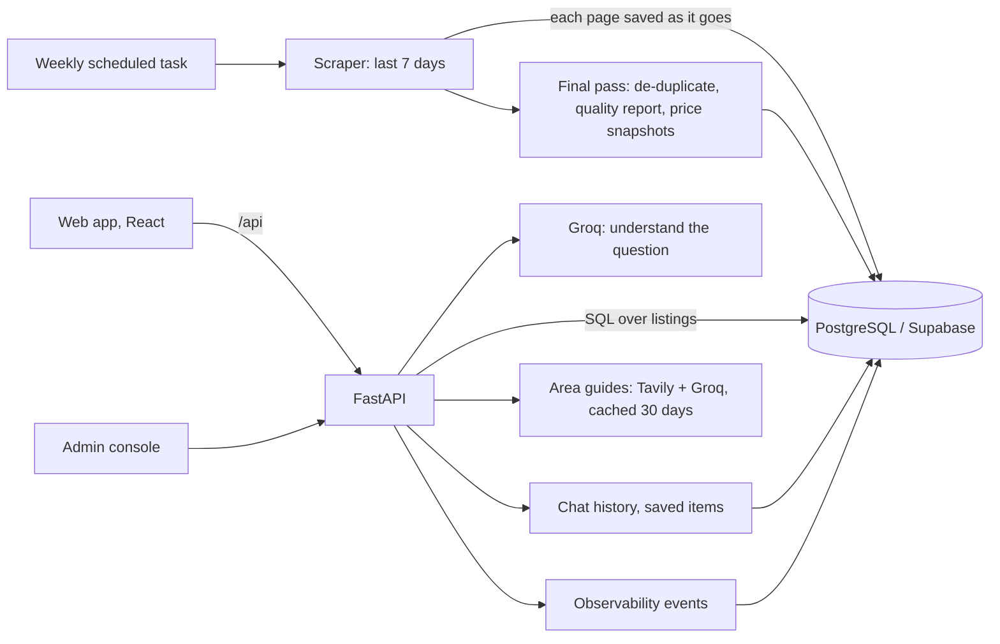

# Lagos Rent

**Know what rent in Lagos really costs, before you start calling agents.**

Lagos Rent is a web app that answers rent questions, such as *"How much is a 2 bedroom in Yaba?"*, using real property listings collected every week. It shows the typical rent, the price range, how many listings the answer is based on, and the listings themselves.

---

## The problem

Finding a place to rent in Lagos is hard to do well:

- **Prices are scattered and unclear.** Listings are spread across many websites and agents. There is no single, trustworthy answer to "what should a 2 bedroom in Gbagada cost this year?"
- **Asking prices vary wildly.** The same kind of flat can be listed at very different prices. Without a sense of the normal range, it is hard to know when a price is fair, high or suspicious.
- **The first payment is much more than the rent.** Agency, legal and caution fees, often with one or two years paid upfront, can make the cash needed to move in far higher than the yearly rent.
- **Areas are hard to judge from a distance.** Traffic, flooding, power supply and safety matter as much as price, and that information is scattered across the web.
- **Old figures mislead.** Rent moves quickly. Blog posts and word-of-mouth prices go out of date.

## What Lagos Rent does about it

| You want to know | Lagos Rent gives you |
| --- | --- |
| "How much is a 2 bedroom in Yaba?" | The **typical rent** and the **range most listings fall in**, worked out from listings posted in the last few weeks, plus the listings themselves. |
| "Is this answer reliable?" | Every answer says **how many listings it is based on** and how recent they are, with a plain confidence label. When there is too little data, it says so instead of guessing. |
| "What will I actually pay to move in?" | A **move-in cost calculator**: rent plus agency, legal and caution fees, service charge and moving costs, all editable. |
| "What is it like to live there?" | **Area guides** covering commute, flooding, electricity, safety and amenities, summarised from web sources that are linked so you can check them. |
| "Yaba or Surulere?" | **Side-by-side comparison** of up to three areas for the size you need. |
| "Are prices going up?" | **Weekly price trends** per area and size. |
| "Where was I?" | **Chat history**, **saved searches** and **favourite listings**, kept on your device with no sign-up. |

### Principles

- **Every price comes from a real listing.** The AI only reads your question; it never invents prices. Rent figures are calculated from stored listings, and each answer links back to them.
- **Honest about uncertainty.** Answers show how many listings they rest on, and flag listings whose price looks mistyped.
- **Fresh data.** Listings are collected weekly, and only those posted in the last 7 days are added.
- **Private by default.** No accounts, no IP addresses, no personal data. History and saved items are tied to a random ID kept in your browser.

### Why there is no sign-up

Lagos Rent has **no user registration, on purpose**. Checking what rent costs should take seconds, not a form, an email confirmation and a password. Asking for nothing also means there is no personal data to protect, leak or sell.

What this means in practice:

- You can use every feature straight away: asking, area guides, comparisons, the move-in calculator, chat history, saved searches and favourites.
- Your chats and saved items are linked to a random ID stored in your browser. They stay on that browser; they do not follow you to another phone or laptop, and clearing your browser data removes the link to them.
- The only accounts in the system are for the site's administrators, created from the command line.

---

## Using the app

1. **Ask** a question in plain words, or tap an area, a size and a budget.
2. **Read the answer:** the typical rent, the range, a breakdown by size, and the listings behind it.
3. **Follow up** in the same chat ("what about a 3 bedroom?"). The app remembers what you were asking about.
4. **Open your chats** any time from *Your chats*, start a *New chat*, or delete old ones.
5. **Explore** *Area guides*, *Compare*, *Move-in cost* and *Saved* from the top menu.

---

## For developers

### How it works



1. **Collect.** A weekly task scrapes rent listings from public Nigerian property sites, newest first. It keeps listings dated within the last 7 days, respects each site's robots.txt, and skips any site that refuses access.
2. **Store.** Each scraped page is cleaned (area names, monthly to yearly prices) and saved straight away, so a stopped run never loses work and the next run resumes. A final pass removes duplicates, writes a quality report and updates weekly price snapshots.
3. **Answer.** The API uses an LLM only to turn the question into structured filters (area, bedrooms, budget). Prices come from SQL over stored listings and are returned as a typed answer with range method and confidence.
4. **Remember.** Each conversation is a thread. Questions and answers are saved per device, and the thread ID doubles as the follow-up memory key.

### Tech stack

| Layer | Tools |
| --- | --- |
| Backend | Python 3.12, FastAPI, SQLAlchemy, Pydantic, Typer |
| Data | PostgreSQL (Supabase), pandas, RapidFuzz |
| AI | Groq (question understanding, guide writing), Tavily (web search) |
| Scraping | requests, BeautifulSoup |
| Frontend | React 19, TypeScript, Vite, Tailwind CSS, TanStack Query |
| Tooling | uv, Ruff, mypy, pytest, Vitest, ESLint |
| Hosting | Vercel (frontend), Render (API), Supabase (database), Windows Task Scheduler (weekly scrape) |

### Run it locally

Prerequisites: [uv](https://docs.astral.sh/uv/) (installs Python 3.12), Node.js 20+, a PostgreSQL database (Supabase works out of the box), and API keys for [Groq](https://console.groq.com) and [Tavily](https://tavily.com).

```bash
git clone https://github.com/Jaywestty/Lagos-Rent-Predictor.git
cd Lagos-Rent-Predictor
cp .env.example .env                      # fill in the values below
uv sync
npm install --prefix frontend
uv run python -m entrypoints.cli migrate  # create tables
```

```bash
uv run uvicorn entrypoints.api:app --port 8000   # API
npm run dev --prefix frontend                     # web app on http://localhost:5173 (proxies /api to :8000)
```

### Environment variables

| Variable | Required | Purpose |
| --- | --- | --- |
| `DATABASE_URL` | Yes | Postgres connection string. For Supabase use the Session pooler URI. TLS is enabled automatically for remote hosts. |
| `GROQ_API_KEY` | Yes | Understanding questions and writing area guides |
| `TAVILY_API_KEY` | Yes | Web search for area guides and general advice |
| `GROQ_MODEL` | No | Defaults to `openai/gpt-oss-120b` |
| `ALLOWED_ORIGINS` | No | Comma-separated origins allowed to call the API directly (CORS). Not needed with the Vercel proxy setup. |
| `ADMIN_EMAIL`, `ADMIN_PASSWORD` | No | Used once by `create-admin` |
| `API_PROXY_TARGET` | No | Frontend dev only: where Vite proxies `/api` (default `http://localhost:8000`) |

Never commit `.env`.

### Loading data

```bash
uv run python -m entrypoints.cli weekly-scrape --since-days 7 --max-pages 30   # scrape and load
uv run python -m entrypoints.cli warm-guides --top 15                           # pre-build area guides
uv run python -m entrypoints.cli load-run                                       # load a stopped run's file
```

**Weekly schedule (Windows).** Some listing sites refuse requests from cloud servers, so the weekly scrape runs on a local machine:

```powershell
powershell -ExecutionPolicy Bypass -File scripts\register-weekly-task.ps1 -StartDate 2026-11-30
Start-ScheduledTask -TaskName "Lagos Rent weekly scrape"      # run now
Unregister-ScheduledTask -TaskName "Lagos Rent weekly scrape" # remove
```

The task runs every Monday at 00:00 and catches up if the machine was off. Logs go to `logs\weekly-scrape-*.log`. Runs can be stopped at any time; finished pages are kept and the next run continues from there (`--resume-hours`, default 72).

`.github/workflows/weekly-scrape.yml` allows manual cloud runs (**Run workflow** in GitHub Actions) for sites that accept cloud traffic.

### Admin console

The admin console lives at `/admin` and is not linked from the public site. Accounts can only be created from the command line:

```bash
uv run python -m entrypoints.cli create-admin
```

It covers usage analytics, scraper operations (live progress with a Stop button), and observability: traffic, latency, errors with stack traces, AI and search calls with token counts, data quality, and a per-request trace. Sessions use Argon2-hashed passwords, HttpOnly cookies, CSRF tokens and login lockout. A run whose progress heartbeat goes quiet for 5 minutes is marked *interrupted* automatically.

### Deployment

- **Frontend on Vercel.** Project root `frontend`. `frontend/vercel.json` serves the single-page app and forwards `/api/*` to the API, so the browser sees one origin (cookies and CORS just work). Replace `YOUR-RENDER-SERVICE` in it with your Render service name.
- **API on Render.** `render.yaml` is a ready Blueprint: build `uv sync --frozen --no-dev`, start `uvicorn entrypoints.api:app`, health check `/health`. Set `DATABASE_URL`, `GROQ_API_KEY` and `TAVILY_API_KEY` in Render.
- **Database on Supabase.** Run `uv run python -m entrypoints.cli migrate` once against it.
- **Scraping** stays on a local machine (see above). It writes to the same database.

### Testing and quality

```bash
uv run pytest                       # backend tests (never touch the real database)
uv run ruff check
npm test --prefix frontend
npm run lint --prefix frontend
npm run build --prefix frontend     # includes a bundle size budget
```

### Project structure

```
admin/          Admin API: auth, analytics, operations, observability
advice/         Web search, advice answers and area guides
conversation/   Follow-up memory and chat history
entrypoints/    FastAPI app, public API routes and the Typer CLI
eval/           Extraction and advice evaluation sets
observability/  Request, error, AI-call and usage event recording
pipeline/       Loader with de-duplication and a quality report
query/          Question parsing, SQL queries, stats, trends and answer shape
scraping/       Scrapers, location normaliser, and the scrape-and-load runner
scripts/        Windows scheduled-task scripts
sql/            Base schema and numbered migrations
frontend/       React web app and admin console
tests/          Backend tests
```

### API overview

| Method | Path | Description |
| --- | --- | --- |
| `POST` | `/api/chat` | Ask a question (`session_id` = chat thread id); returns a typed answer plus matching listings |
| `GET` | `/api/areas`, `/api/areas/{area}` | Areas with typical rent; one area's rent by size and trend |
| `GET` | `/api/areas/{area}/guide`, `/trends`, `/listings` | Area guide with sources, weekly trend, newest listings |
| `GET` | `/api/compare?areas=A,B,C&beds=2` | Side-by-side comparison |
| `GET` `DELETE` | `/api/me/threads`, `/api/me/threads/{id}` | Chat history for this device |
| `GET` `POST` `DELETE` | `/api/me/saved-searches`, `/api/me/favorites` | Saved items for this device |
| `GET` | `/health` | Health check |

Per-device endpoints need an `X-Client-Id` header (a random UUID the browser keeps). Admin endpoints live under `/api/admin` and require an admin session.

### Data notes

- Lagos rent is quoted per year. Monthly prices are multiplied by 12. A listing with no stated period is treated as yearly.
- Ranges use the 10th to 90th percentile once there are 10 or more listings, and lowest to highest below that.
- Confidence is *solid* at 10 or more listings, *limited* at 4 to 9, and *very little data* at 3 or fewer.
- Some source listings tag a yearly price as monthly. These are flagged on listing cards and in the admin data-quality view.
