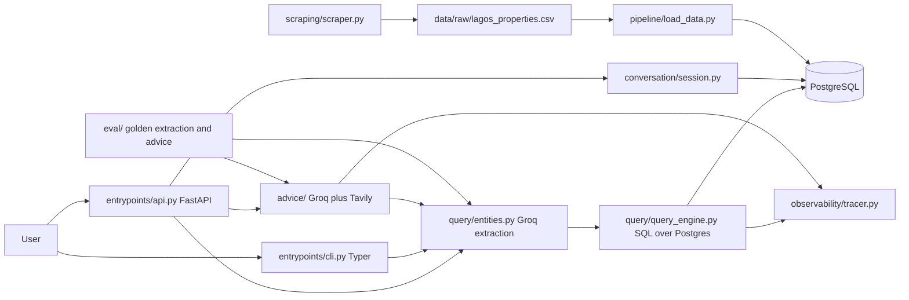

# Lagos Rent Assistant

A conversational rent research app for Lagos residents. A user asks a question in natural language, for example how much is rent in Gbagada or what about a 2 bedroom, and gets an answer built only from scraped listings stored in PostgreSQL.

Core rule: every rent figure must be traceable to actual listings. When the database cannot support an answer, the interface must say so. The UI must never look more confident than the data.

## Architecture



## Repo layout

- entrypoints/ : FastAPI app and Typer CLI
- query/ : entity extraction, SQL query engines and response builders
- conversation/ : session storage with a 6 hour TTL
- advice/ : Tavily search plus Groq grounded synthesis
- observability/ : trace stages and call counts in the traces table
- scraping/ : NigeriaPropertyCentre and PropertyPro scrapers and location normalizer
- pipeline/ : CSV loader with dedup and quality report, plus one off backfills
- sql/ : schema for listings, location aliases, sessions and traces
- eval/ : golden extraction cases and advice evaluation scripts
- data/ : scraper output and known area files (local, gitignored)
- docs/ : orientation.md, cleanup.md and later handoff notes
- frontend/ : planned React app in Phase 5, not present yet

## Prerequisites

- uv that can install Python 3.12
- Python 3.12 (see .python-version)
- Node LTS (needed for Phase 5 frontend)
- PostgreSQL 16 (or local Postgres on port 5432)
- Docker for docker-compose.yml

## Setup

```powershell
Copy-Item .env.example .env
# Edit .env and set POSTGRES_USER, POSTGRES_PASSWORD, POSTGRES_DB,
# POSTGRES_HOST, POSTGRES_PORT, GROQ_API_KEY, TAVILY_API_KEY, GROQ_MODEL.
docker compose up -d postgres
uv sync
```

## Environment variables

Built from config.py, db.py and .env.example:

| Variable | Required | Default | Used for |
| --- | --- | --- | --- |
| POSTGRES_USER | no | lagos_rent | Postgres user |
| POSTGRES_PASSWORD | no | lagos_rent | Postgres password |
| POSTGRES_DB | no | lagos_rent | Postgres database |
| POSTGRES_HOST | no | localhost | Postgres host |
| POSTGRES_PORT | no | 5432 | Postgres port |
| GROQ_API_KEY | yes for extraction and advice | none | Groq entity extraction and advice synthesis |
| TAVILY_API_KEY | yes for advice | none | Tavily web search for advice |
| GROQ_MODEL | no | openai/gpt-oss-120b | Groq model name |

Never commit .env. Never print its values.

## How to run

Backend:

```powershell
uv run uvicorn entrypoints.api:app --host 0.0.0.0 --port 8000
```

CLI:

```powershell
uv run python -m entrypoints.cli query "2 bedroom in Gbagada"
uv run python -m entrypoints.cli chat
uv run python -m entrypoints.cli serve
```

Scraper (writes data/raw/lagos_properties.csv):

```powershell
uv run python scraping/scraper.py --site npc --category houses --type rent --max-pages 5
```

Pipeline load (applies sql/schema.sql and upserts listings):

```powershell
uv run python pipeline/load_data.py --csv data/raw/lagos_properties.csv
```

Evals (need live Groq and Tavily keys; advice eval uses live web search):

```powershell
uv run python eval/extraction_eval.py
uv run python eval/advice_eval.py
```

Frontend:

```powershell
npm install --prefix frontend
npm run dev --prefix frontend
npm test --prefix frontend
npm run build --prefix frontend
npm run lint --prefix frontend
```

Migrations and admin creation:

```powershell
uv run python -m entrypoints.cli migrate
uv run python -m entrypoints.cli create-admin
```

Tests:

```powershell
uv run pytest
uv run ruff check
uv run mypy
```

## API contract

### Public endpoints (implemented)

GET /health:

```json
{ "status": "ok" }
```

POST /query with JSON body:

```json
{ "query": "2 bedroom in Gbagada", "session_id": "optional string" }
```

Response depends on query type. All responses include query_type.

Lookup:

```json
{
  "query_type": "lookup",
  "matched_count": 3,
  "message": "Found 3 matching listing(s).",
  "results": [
    { "title": "string", "price": "NGN 1500000/year", "area": "Gbagada", "subarea": "string", "bedrooms": 2, "url": "string" }
  ]
}
```

Lookup with no matches returns matched_count 0 and an empty results list.

Affordability (budget question):

```json
{
  "query_type": "affordability",
  "budget_ngn": 500000,
  "matched_count": 2,
  "message": "string",
  "areas": [
    { "area": "string", "matched_count": 2, "sparse": false, "results": [] }
  ],
  "stretch_options": []
}
```

Comparison (two or more options):

```json
{
  "query_type": "comparison",
  "message": "string",
  "options": [
    { "label": "2 bedroom in Ikeja", "matched_count": 2, "caveat": null, "cheapest": "NGN 1200000/year", "results": [] }
  ]
}
```

Advice (general renting questions):

```json
{
  "query_type": "advice",
  "answer": "string",
  "sources": [ { "title": "string", "url": "string" } ]
}
```

POST /api/chat and POST /api/chat/stream return a typed versioned answer with status (success, low_data, no_data, clarification, out_of_scope, error), headline, 4 property breakdowns, median, listing count, range method (percentile for 10 plus or min_max), data as of, confidence, follow ups, request id and latency. POST /api/chat/stream sends SSE events status, delta, final and error. Both support X-Request-Key idempotency and a request timeout. POST /query keeps legacy keys and also adds answer.

Admin routes under /admin implement login, logout, me, analytics overview with six KPIs, questions over time, top areas, recent questions, scraper runs, freshness, review queue, manual scrape with polling and logs, and PATCH review. All require a session cookie and CSRF token for state changes.

## Data rules

- Rent is quoted per year in Lagos. The query engine annualizes monthly prices as price_ngn times 12 and treats year and null periods as already annual. Do not mix monthly and yearly figures silently.
- The scraper detects period from page text. PropertyPro often omits period on the primary listing. Null period is treated as annual by the query engine, which is a known risk.
- Pipeline sanity checks flag monthly rent above 10,000,000 NGN and yearly rent below 300,000 NGN, missing period on rent rows, property_type equal to lagos and missing locations. These flags live in the quality report only.
- Deduplication groups by bedrooms, area, property_type and listing_type, then compares price within 5 percent and title similarity. High confidence pairs set is_duplicate_of. Medium pairs were intended as dedup_review_flag but that column was dropped before insert, so review flags are only in the report count.
- Stale rows are never retired by the loader. Postgres can hold rows that are no longer in the current CSV.
- Session memory keeps the last entities per session_id and expires after 6 hours. New queries inherit fields that are not explicitly changed.

## Roadmap

- Next milestone is hosted database and CI/CD scraping. The callable scraper function seam, scraper_runs table and environment variables will make that possible. That work is described in docs/next-steps.md after Phase 6.
- Phase 4A adds the typed answer contract with percentile ranges and confidence.
- Phase 4B adds analytics logging and migrations.
- Phase 4C adds the admin API.
- Phase 5 adds the React frontend and admin UI.
- Phase 6 is verification and handoff.

## Notes

- README was previously about the old Streamlit predictor. That project was removed in Phase 1. See docs/orientation.md for the actual architecture and docs/cleanup.md for what was removed.
- The earlier status audit is folded into the Roadmap and Data rules sections above because it is no longer accurate in full: observability is now committed, .env.example exists, GROQ_MODEL is env configurable, and requirements were replaced by pyproject.toml and uv.lock in Phase 2. Known code smells from that audit that still apply are the duplicate listing_type filter in build_lookup_query, the stray numpy.ma import in pipeline/load_data.py, the page wide price regex in scraping/scraper.py and the missing dedup_review_flag column.
